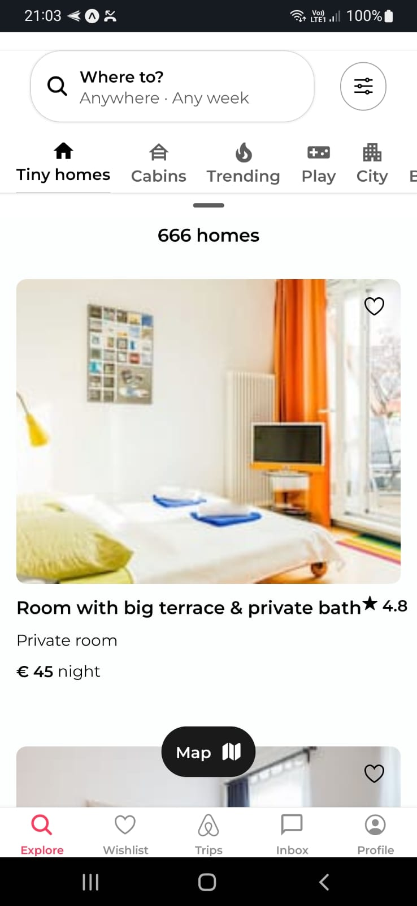
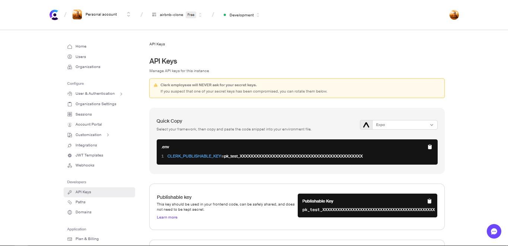
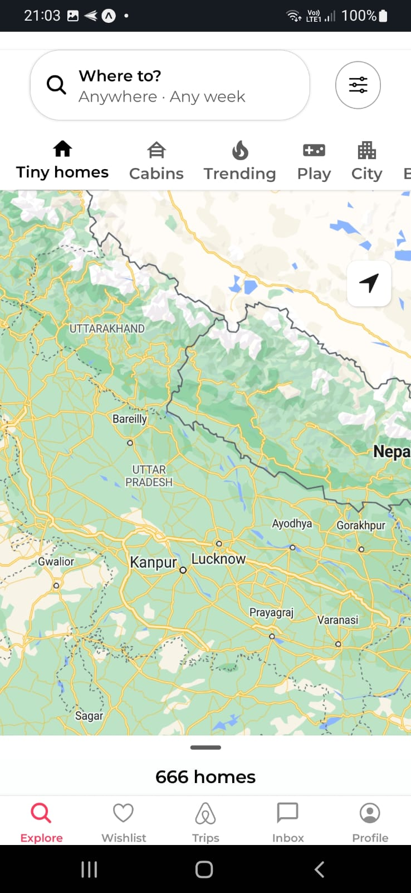
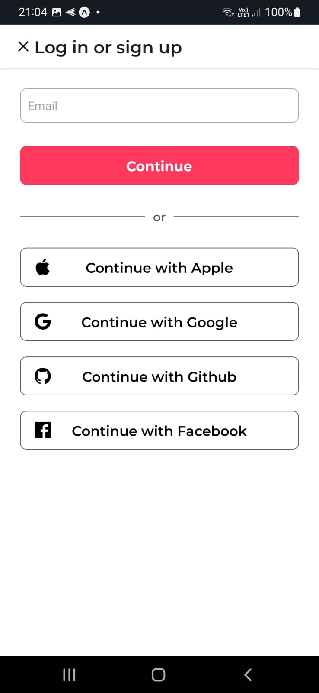
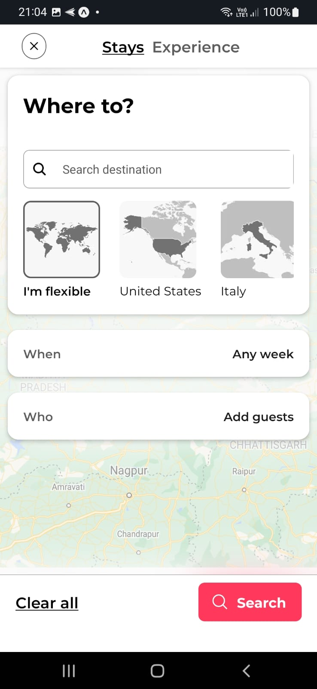

<a name="readme-top"></a>

# Airbnb Clone Application using Expo & React Native

<p align="center">
    
</p>

[](https://github.com/sanidhyy "Ask Me Anything!")
[](https://github.com/sanidhyy/airbnb-clone/blob/main/LICENSE "GitHub license")
[](https://github.com/sanidhyy/airbnb-clone/commits/main "Maintenance")
[](https://github.com/sanidhyy/airbnb-clone/branches "GitHub branches")
[](https://github.com/sanidhyy/airbnb-clone/commits "Github commits")
[](https://github.com/sanidhyy/airbnb-clone/issues "GitHub issues")
[](https://github.com/sanidhyy/airbnb-clone/pulls "GitHub pull requests")

<!-- Table of Contents -->
<details>

<summary>

# :notebook_with_decorative_cover: Table of Contents

</summary>

- [Folder Structure](#bangbang-folder-structure)
- [Getting Started](#toolbox-getting-started)
- [Screenshots](#camera-screenshots)
- [Tech Stack](#gear-tech-stack)
- [Contribute](#raised_hands-contribute)
- [Acknowledgements](#gem-acknowledgements)
- [Buy Me a Coffee](#coffee-buy-me-a-coffee)
- [Follow Me](#rocket-follow-me)
- [Give A Star](#star-give-a-star)
- [Star History](#star2-star-history)
- [Give A Star](#star-give-a-star)

</details>

## :bangbang: Folder Structure

Here is the folder structure of Airbnb Clone.

<!--- FOLDER_STRUCTURE_START --->

```bash
airbnb-clone/
  |- app/
    |-- (modals)/
    |-- (tabs)/
    |-- listing/
    |-- _layout.tsx
  |- assets/
  |- components/
    |-- ExploreHeader.tsx
    |-- Listings.tsx
    |-- ListingsBottomSheet.tsx
    |-- ListingsMap.tsx
    |-- ModalHeaderText.tsx
  |- constants/
    |-- Colors.ts
    |-- Styles.ts
  |- hooks/
    |-- useWarmUpBrowser.ts
  |- .env.example
  |- .env/.env.local
  |- .gitignore
  |- app.json
  |- babel.config.js
  |- metro.config.js
  |- pnpm-lock.yaml
  |- pnpm-workspace.yaml
  |- package.json
  |- tsconfig.json
```

<!--- FOLDER_STRUCTURE_END --->

<br />

## :toolbox: Getting Started

1. Make sure **Git** and **NodeJS** is installed.
2. Clone this repository to your local computer.
3. Create `.env` file in root folder.
4. Contents of `.env`:

```bash
# .env file
EXPO_PUBLIC_CLERK_PUBLISHABLE_KEY=pk_test_XXXXXXXXXXXXXXXXXXXXXXXXXXXXX
```

5. Open a terminal in the root directory and run `npm install` or `pnpm install`.

6. **Clerk Key**:
   - `EXPO_PUBLIC_CLERK_PUBLISHABLE_KEY` is provided by Clerk. You need to sign up for an account on Clerk (https://www.clerk.dev/), log in, create new project and access this key in your project settings.



7. Now app is fully configured :+1: and you can start using this app using `npm start` or `pnpm start`.

### :books: Additional Resources

- Expo Documentation: https://docs.expo.dev/
- React Native Documentation: https://reactnative.dev/docs/
- Clerk Documentation: https://clerk.com/docs

**NOTE:** Please make sure to keep your API keys and configuration values secure and do not expose them publicly.

### :raising_hand: Need Help?

If you run into issues during installation or setup:

- **GitHub Discussions** — [Open a Q&A discussion](https://github.com/sanidhyy/airbnb-clone/discussions/new?category=q-a) for setup and troubleshooting help.
- **Email** — [sanidhyyy@gmail.com](mailto:sanidhyyy@gmail.com)
- **Discord** — `@sanidhyy`

## :camera: Screenshots:

<p align="center">


</p>

<p align="center">


</p>

## :gear: Tech Stack

[](https://react.dev/ "React JS") [](https://developer.mozilla.org/en-US/docs/Web/JavaScript/ "JavaScript") [](https://developer.mozilla.org/en-US/docs/Web/CSS "CSS") [](https://jestjs.io/ "Jest") [](https://babeljs.io/ "Babel")

## :raised_hands: Contribute

You might encounter some bugs while using this app. You are more than welcome to contribute. Just submit changes via pull request and I will review them before merging. Make sure you follow community guidelines.

## :gem: Acknowledgements

Useful resources and libraries that are used in My Portfolio

<!--- DEPENDENCIES_START --->

- [@babel/core](https://www.npmjs.com/package/@babel/core): ^7.29.13
- [@clerk/expo](https://www.npmjs.com/package/@clerk/expo): ^4.17.2
- [@expo/metro-runtime](https://www.npmjs.com/package/@expo/metro-runtime): ~58.0.17
- [@expo/vector-icons](https://www.npmjs.com/package/@expo/vector-icons): ^15.0.2
- [@gorhom/bottom-sheet](https://www.npmjs.com/package/@gorhom/bottom-sheet): ^5.2.14
- [@react-native/jest-preset](https://www.npmjs.com/package/@react-native/jest-preset): 0.88.1
- [@react-native/metro-config](https://www.npmjs.com/package/@react-native/metro-config): 0.88.1
- [@types/react](https://www.npmjs.com/package/@types/react): ^19.3.0
- [babel-preset-expo](https://www.npmjs.com/package/babel-preset-expo): ^58.0.26
- [expo](https://www.npmjs.com/package/expo): ~58.0.26
- [expo-application](https://www.npmjs.com/package/expo-application): ~58.1.2
- [expo-auth-session](https://www.npmjs.com/package/expo-auth-session): ~58.0.19
- [expo-blur](https://www.npmjs.com/package/expo-blur): ~58.0.6
- [expo-constants](https://www.npmjs.com/package/expo-constants): ~58.0.16
- [expo-crypto](https://www.npmjs.com/package/expo-crypto): ~58.0.8
- [expo-font](https://www.npmjs.com/package/expo-font): ~58.0.12
- [expo-haptics](https://www.npmjs.com/package/expo-haptics): ~58.0.8
- [expo-image-picker](https://www.npmjs.com/package/expo-image-picker): ~58.0.10
- [expo-linking](https://www.npmjs.com/package/expo-linking): ~58.0.17
- [expo-location](https://www.npmjs.com/package/expo-location): ~58.0.22
- [expo-router](https://www.npmjs.com/package/expo-router): ~58.0.32
- [expo-secure-store](https://www.npmjs.com/package/expo-secure-store): ~58.0.3
- [expo-splash-screen](https://www.npmjs.com/package/expo-splash-screen): ~58.0.14
- [expo-status-bar](https://www.npmjs.com/package/expo-status-bar): ~58.0.5
- [expo-system-ui](https://www.npmjs.com/package/expo-system-ui): ~58.0.7
- [expo-web-browser](https://www.npmjs.com/package/expo-web-browser): ~58.1.0
- [jest](https://www.npmjs.com/package/jest): ^30.5.2
- [jest-expo](https://www.npmjs.com/package/jest-expo): ~58.0.15
- [react](https://www.npmjs.com/package/react): 19.3.0
- [react-dom](https://www.npmjs.com/package/react-dom): 19.3.0
- [react-native](https://www.npmjs.com/package/react-native): 0.88.1
- [react-native-calendars](https://www.npmjs.com/package/react-native-calendars): ^1.1314.0
- [react-native-gesture-handler](https://www.npmjs.com/package/react-native-gesture-handler): ~3.3.0
- [react-native-map-clustering](https://www.npmjs.com/package/react-native-map-clustering): ^4.0.0
- [react-native-maps](https://www.npmjs.com/package/react-native-maps): 1.29.11
- [react-native-reanimated](https://www.npmjs.com/package/react-native-reanimated): 4.7.1
- [react-native-safe-area-context](https://www.npmjs.com/package/react-native-safe-area-context): ~5.11.1
- [react-native-screens](https://www.npmjs.com/package/react-native-screens): ~4.30.1
- [react-native-web](https://www.npmjs.com/package/react-native-web): ~0.21.4
- [react-native-worklets](https://www.npmjs.com/package/react-native-worklets): 0.13.0
- [react-test-renderer](https://www.npmjs.com/package/react-test-renderer): 19.3.0
- [typescript](https://www.npmjs.com/package/typescript): ~6.0.3

<!--- DEPENDENCIES_END --->

## :coffee: Buy Me a Coffee

[](https://www.buymeacoffee.com/sanidhy "Buy me a Coffee")

## :rocket: Follow Me

[](https://github.com/sanidhyy "Follow Me")
[](https://x.com/intent/tweet?text=Wow:&url=https%3A%2F%2Fgithub.com%2Fsanidhyy%2Fmedical-chat-app "Tweet")

## :star: Give A Star

You can also give this repository a star to show more people and they can use this repository.

## :star2: Star History

<a href="https://star-history.com/#sanidhyy/airbnb-clone&Timeline" title="Github Star History">
  <picture>
    <source media="(prefers-color-scheme: dark)" srcset="https://api.star-history.com/svg?repos=sanidhyy/airbnb-clone&type=Timeline&theme=dark" />
    <source media="(prefers-color-scheme: light)" srcset="https://api.star-history.com/svg?repos=sanidhyy/airbnb-clone&type=Timeline" />
    
  </picture>
</a>

<br />
<p align="right">(<a href="#readme-top" title="Back to top">back to top</a>)</p>
